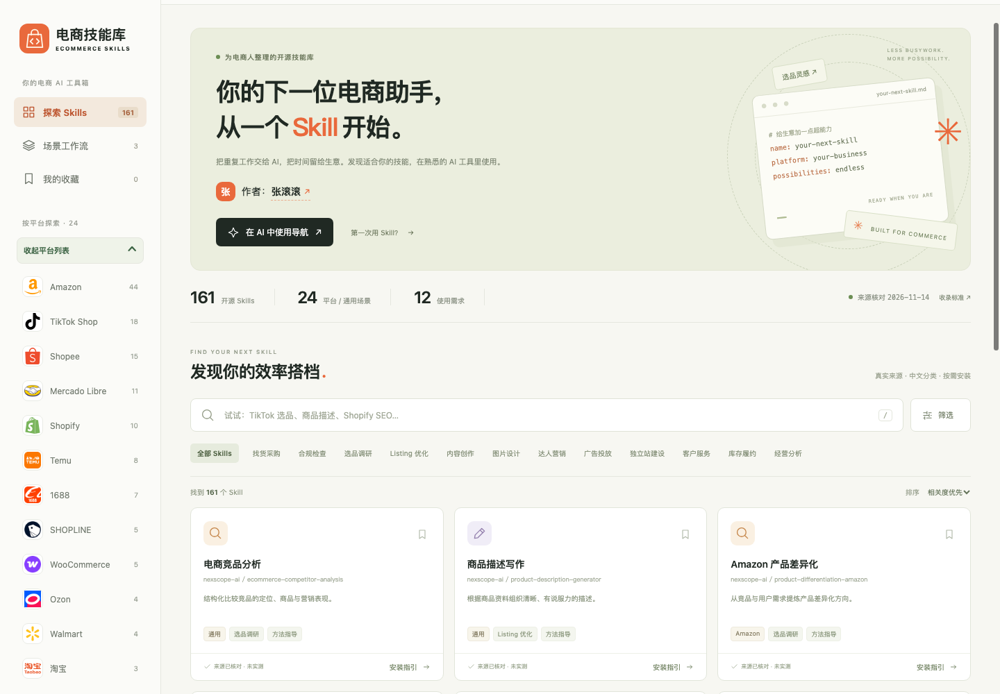

# 电商技能库 · 张滚滚的 AI 技能导航

**做电商，想用 AI 帮忙，却不知道该用哪个工具？来这里按需求找。**

选品、写商品文案、做主图、找达人、看广告数据……我把散落在不同开源项目里的电商 AI 技能整理到一起。你可以像逛工具箱一样，按自己做的平台、手头要解决的问题，找到合适的技能。

作者：[张滚滚](https://github.com/zarockfat) · Skill 名称：`zgg-find-ecommerce-skills`

**自带本地可视化网页** · 安装后首次使用，AI 会给出本机网页链接，点开即可按平台和需求挑选技能。

## 先看看长什么样

左边选平台，中间搜需求，点开技能就能看用途、使用条件、费用说明和安装方法。



[点击查看大图](docs/images/homepage.png)

## 它能帮你找什么？

| 你手头的事 | 可以这样找 |
| --- | --- |
| 想找有机会卖的商品 | “Amazon 选品”“TikTok 爆品分析” |
| 商品文案不知道怎么写 | “商品标题”“卖点提炼”“商品描述” |
| 想做商品图和短视频 | “商品主图”“产品图片”“短视频内容” |
| 想找达人带货 | “TikTok Shop 达人筛选” |
| 想改善广告和店铺经营 | “广告分析”“库存管理”“客服” |

目前已整理 **161 个技能**，覆盖 Amazon、TikTok Shop、Shopee、Shopify、Temu、1688 等平台，也有多个平台都能用的技能。

## Skill 是什么？

可以把 Skill 理解为一份**让 AI 按特定方法做事的工作指南**。有的帮助写内容、整理思路，有的还会连接数据工具或店铺服务。

这个导航技能负责先帮你找到合适的技能。选好后，再安装对应技能、准备商品资料或数据，让 AI 帮你完成具体任务。

## 怎么用？

### 方式一：在网页里找

1. 选你做的平台，例如 Amazon、TikTok Shop。
2. 输入需求，例如“选品”“达人”“商品描述”。
3. 点开感兴趣的技能，查看用途、费用和准备条件，按安装指引使用。

安装 Skill 后，第一次使用时 AI 会提供本地网页链接；也可以直接说“打开电商技能库的本地网页”。页面随安装包提供，打开无需账号，国内网络或断网都能浏览。安装与联网更新本身仍需能访问 GitHub。想自行运行项目，见[网页运行说明](docs/DEVELOPMENT.md#本地启动)。

### 方式二：在 AI 聊天里直接说

安装后第一次使用，AI 会欢迎你并给出“打开电商技能库”的本地网页链接；之后不会反复提示。随时说“打开网页版”也能再次获得链接。

在支持 Skill 的 AI 工具里输入：

```text
使用 $zgg-find-ecommerce-skills，帮我找适合 TikTok Shop 达人筛选的技能，列出用途、费用和安装方式。
```

也可以换成你自己的需求：

> 我做 Amazon，帮我找能优化商品标题和卖点的技能。
>
> 我想找 1688 货源，优先推荐不需要付费接口的技能；费用不明确的请标出来。

### 安装导航 Skill

如果你用 Codex，在项目终端执行下面这条命令（需要 Node.js 22.20+ 和网络）：

```bash
npx skills add zarockfat/zgg-find-ecommerce-skills --skill zgg-find-ecommerce-skills -a codex
```

**用的是 WorkBuddy、豆包或其他 AI 工具？** 网页的安装指引也提供了相应选项：

- WorkBuddy：下载完整技能包，在“技能 → 添加技能 → 上传技能”导入。
- 豆包 / 豆包工作：先确认当前版本是否有导入入口，再查看对应步骤；普通聊天和应用插件的能力不同。
- TRAE、CodeBuddy、Kimi Code CLI、Qwen Code、OpenClaw 等：按所选工具生成安装命令。
- 其他 Agent：使用安装器选择客户端，或按工具自己的官方指引导入。

[查看各 AI 工具的完整安装说明与官方来源](docs/AI-CLIENTS.md)。安装后检查技能是否已启用，再描述任务。

不熟悉终端也没关系，可以把下面这句话发给能操作本地文件和终端的 AI 助手：

```text
帮我从 GitHub 仓库 zarockfat/zgg-find-ecommerce-skills 安装 zgg-find-ecommerce-skills，安装到我当前使用的 AI 工具，并检查能否找到它。
```

## 需要自己更新吗？

**装好新版后，正常使用就会检查更新，不用学习 Git 或拉取代码。**

- 使用导航时，每 24 小时最多检查一次；有新目录会自动同步，继续帮你找技能。
- 导航功能有更新时，AI 会提示你，回复“更新”后再按当前工具的方式升级。
- 没有网络时照常使用已有目录；也可以告诉 AI“这次离线使用”。

自动检查需要你的 AI 工具能运行导航脚本。它在你使用时工作，不会在后台常驻。已安装早期版本的用户需要**先更新一次**，以后才有这个能力。本地网页随 Skill 升级，自动同步目录后网页列表也会同步；已打开的页面刷新即可。


```text
帮我从 zarockfat/zgg-find-ecommerce-skills 更新 zgg-find-ecommerce-skills，保留我其他已安装的技能，并检查是否更新成功。
```

## 使用前了解这几件事

- **开源不等于所有服务都免费。** 部分技能需要第三方账号、API 或付费数据，详情页会说明已知条件。
- **先看清用途，再决定是否安装。** 目前核对了技能来源，但尚未逐一验证安装和实际业务效果。
- **这里会持续整理，当前还没有覆盖全网。** 目录中的技能由各自原作者维护，感谢他们的开源贡献。

## 一起把好用的电商技能找出来

发现了好用的技能，或觉得某项介绍不准确，欢迎[提交线索或建议](https://github.com/zarockfat/zgg-find-ecommerce-skills/issues/new)，也欢迎 Star 支持。

开发、网页运行和目录维护方式见[开发说明](docs/DEVELOPMENT.md)；收录要求见[贡献指南](CONTRIBUTING.md)。

本项目原创代码和导航 Skill 使用 [MIT 许可证](LICENSE)。第三方技能及平台图标的权利归各自作者或品牌所有。作者照片用于本项目署名展示，不纳入 MIT 代码授权范围。
